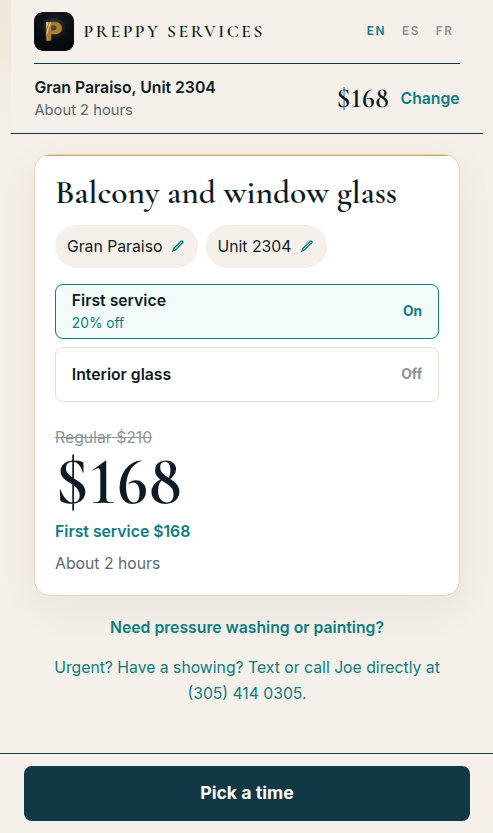
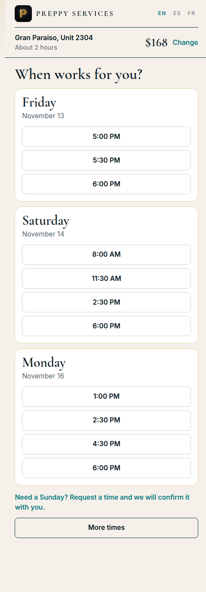
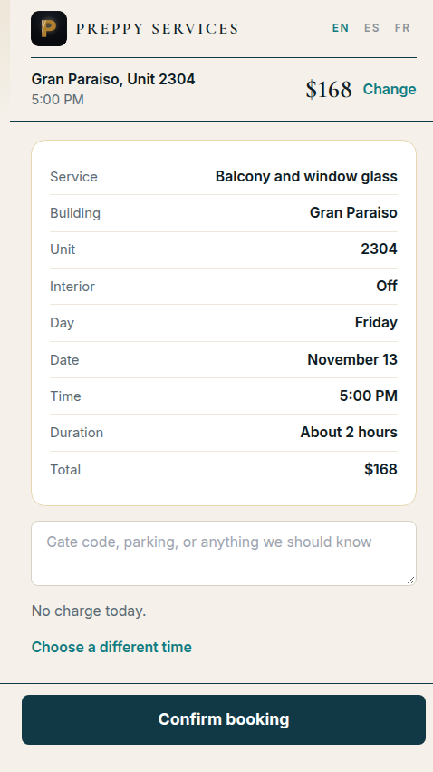
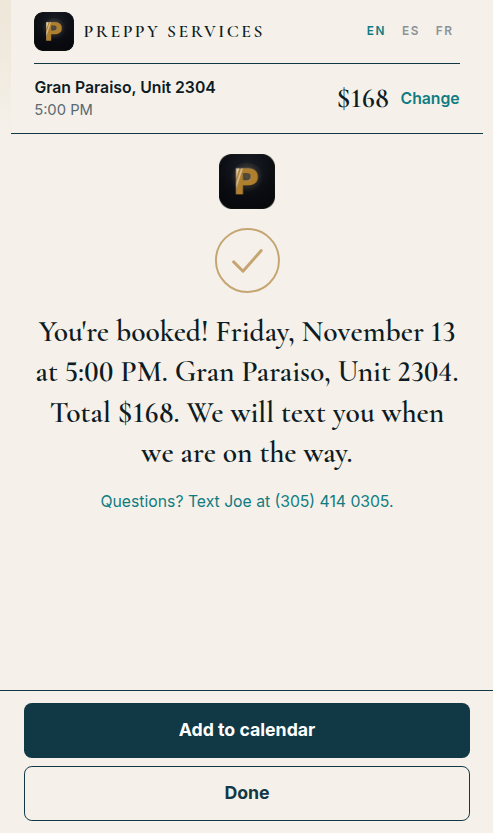
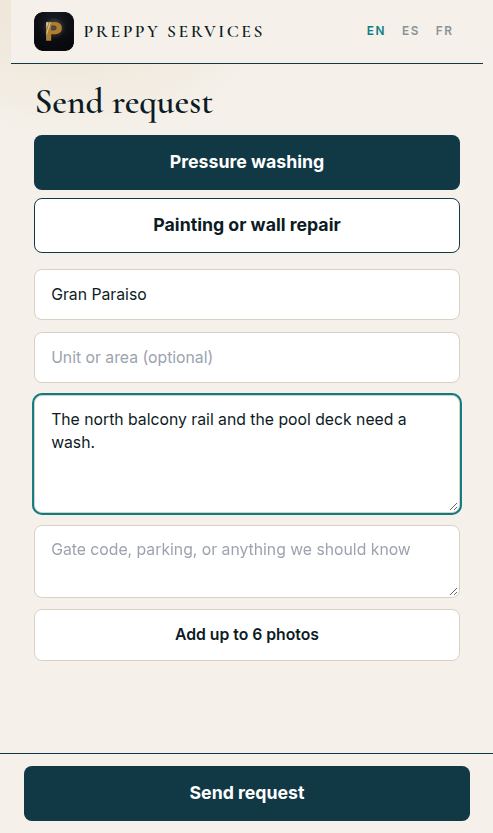

# Booking preview

Preview: https://preppy-services-instant-pricing-scheduling-614w5ilwu.vercel.app

Phone width screens of the glass path and the quote request form. Scheduler writes stay off, so confirming here does not create a Google hold or a Jobber client, request, or job, and it does not change a price in the widget table.

Deep link: `/?b=Gran%20Paraiso&unit=2304&name=Maria&phone=3055550199&email=maria@example.com&intro=1&book=1`

A cold visit opens on an empty "Search your building." field. It does not select 1000 Museum.

## Your price

## Pick a time

Sunday is not offered. The row under the days requests one instead.

## Confirm

Name, phone, and email were already on the link, so the screen does not ask for them again.

## You're booked

## Pressure washing or painting

